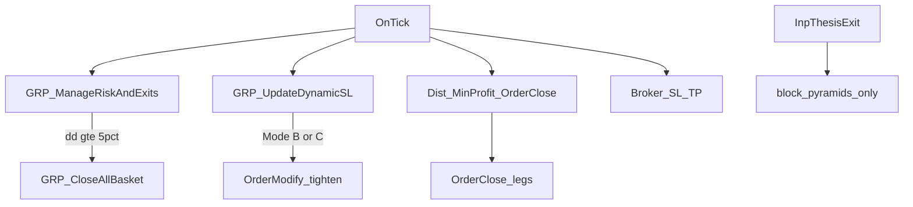

# Exit / Holding Audit (frozen)

**Status:** research audit only — no live deploy.  
**EA under test:** `gold_rush_AI_v0.4.mq5`  
**Preserved baselines:** `gold_rush_AI_v0.3.mq5`, `sets/v0.3_armC_dynamic.set`, all existing v0.4 sets.  
**Primary experiment pin:** `sets/v0.4_armC_dynamic.set` (Mode B).  
**Dist evidence sample (separate book):** `sets/v0.4_armC_l13.set` — do **not** generalize onto dynamic without reproducing exit breakdown + Experts `FLAT` codes on the primary set.

Educational risk framing only. Dual promote (Mode S + WF/holdout) is not claimed by any research digest here.

---

## 1. Samples (kept separate)

### 1.1 Sample L13 — Dist-heavy book

| Field | Value |
|---|---|
| Report | `logs/ReportTester-52016350_v0.4_armC_l13.html` |
| Set | `v0.4_armC_l13.set` |
| Period | M5 2026.01.01–2026.03.01 |
| n | 183 round-trips |
| Label rule | deal comment contains `tp` / `sl`; else `other` |

| Class | n | % | Net (units) |
|---|---|---|---|
| other | 175 | 95.6% | +1887.60 |
| sl | 8 | 4.4% | -568.10 |
| tp | 0 | 0% | 0 |

**Unresolved:** HTML deal comments do not name Dist vs equity-kill. Inference = EA `OrderClose` without tp/sl comment + Experts `FLAT reason=dist_tp` when archived. Without Experts extract for this run, Dist share inside `other` is **not fully proven**.

### 1.2 Sample DYNAMIC — primary experiment baseline

| Field | Value |
|---|---|
| Report | `logs/ReportTester-52016350_v0.4_armC_dynamic.html` |
| Set | `v0.4_armC_dynamic.set` |
| Period | same |
| n | **35** |

| Class | n | % |
|---|---|---|
| sl | 28 | 80% |
| tp | 5 | 14% |
| other | 2 | **6%** |

**Do not claim ~95% other on this set.** Experiment A remains valid: Dist *can* close under Mode B; frequency on this dynamic sample is low.

### 1.3 Sample v0.3 (hostile reference)

214 trips; other ~53% / sl ~28% / tp ~19% — reference only (`logs/hostile_review_trades_v0.3_armC_dynamic.md`).

---

## 2. Source paths — exit authority

| Mechanism | Location | Effect under Mode B/C |
|---|---|---|
| Equity kill | `GRP_ManageRiskAndExits` → `GRP_CloseAllBasket("equity_kill")` | Closes basket — **keep** |
| SL+ / trail | `GRP_UpdateDynamicSL` | `OrderModify` only |
| Dist + MinProfit | OnTick ~4893 / ~4961 / ~5045 (`reason=dist_tp`) | **`OrderClose` basket; historically no ManageMode gate** |
| Broker SL/TP | platform | Independent of EA |
| `InpThesisExit` | pyramid path | Blocks adds; **does not close** |

**Conflict:** Dist flat and Mode B/C trail are independent. Dist can flatten while SL+ is active (unless Dist demoted — Experiment A).

---

## 3. Precedence

### 3.1 Actual (pre–Exp A)

1. Broker SL/TP may fill anytime (server).
2. OnTick: equity kill → protective SL modify → later Dist `OrderClose`.
3. Dist and DynSL do not coordinate.
4. Simultaneous triggers: broker stop fill races EA close; EA `OrderClose` / `OrderModify` failures are logged (`ERR` / Print) but are not a retry state machine.

### 3.2 Target after Experiment A

1. Broker hard SL/TP (platform; EA cannot win the race).
2. Equity DD kill.
3. Thesis close — **deferred** (Exp B; see §5).
4. Protective SL updates (Mode B/C; Chandelier deferred).
5. Dist/MinProfit flat **only if** `InpAllowDistFlat` allows for current ManageMode.

Partials omitted until a later experiment.

---

## 4. ManageMode B vs C (for C1 labeling)

Shared: `UseSLPlus`, `InpSLPlusActivateR`, news-widen branch, tighten-only helper.

| | Mode B | Mode C |
|---|---|---|
| After activate | `max/min(BE+lock, Bid/Ask ± TrailR×R)` | Prefer `GRAI_StructureTrailSL` (swing ± ATR buffer) |
| If no swing | N/A | **Falls back to Mode-B-style BE/price trail** |
| Pure trail-only ablation? | Yes (price/R) | **No** — formula + fallback → label C1 as **mode comparison** vs A |

C2 (Chandelier) must be a single new trail formula on top of A — deferred.

---

## 5. Thesis invalidation — specification + SMC gap

**Available (closed-bar SMC):**

- Pivot confirm: `InpSmcPivotLen` (default 5).
- Trend: `GRAI_SmcTrend()` ∈ {−1, 0, +1}; bias via `GRAI_BiasUpdate()` after `GRAI_SmcUpdate()` on new M5 bar.
- Events: `g_grai_smc_snap.last_event` includes `CHoCH_BULL` / `CHoCH_BEAR`; sweeps do not flip trend.

**Proposed Exp B v1 (not implemented until signed off):**

| Item | Spec |
|---|---|
| TF | Chart M5; once per new closed bar |
| Long invalidation | Open BUY basket and `g_grai_bias == GRAI_BIAS_SHORT` |
| Short invalidation | Open SELL basket and `g_grai_bias == GRAI_BIAS_LONG` |
| FLAT | **Gap:** FLAT = WAIT/not ready — **not** a close signal in v1 |
| Scope | Entire basket (`GRP_CloseAllBasket("thesis")`) |
| Temporary breaks | Wick sweeps already non-trend-flip; no single-candle exit |
| Gap | No per-episode stored entry HL/LH — cannot require “close beyond *this trade’s* HL” without new state |

If opposite-bias-only is rejected as too coarse, **do not implement B** until a pivot-break rule is specified and stored at entry.

---

## 6. Metrics + MFE/MAE limitation

Required per run: net expectancy, profit factor, max DD, exit mix, hold mean/median, long/short, realized P/L.

Path MFE / MAE / peak unrealized / giveback: `scripts/trade_lifecycle_forensics.py` needs `--bars` M5 OHLC. **Without bars: report limitation; do not fabricate.** HTML aggregate MFEMAE is not trade-level giveback.

Success ≠ longer holds alone; require expectancy / PF / DD / giveback jointly.

---

## 7. Hypotheses (evidence-scoped)

| ID | Claim | Scope |
|---|---|---|
| H-DIST | Dist can override Mode B holds | Proven by code; frequency high on **l13**, low on **dynamic sample** |
| H-THES | No structure close | Code |
| H-TRAIL | Trail formula affects giveback | Needs A baseline + C1/C2 + excursion data |

---

## 8. Experiment A (first code change)

**Single delta:** Dist-flat eligibility for ManageMode B/C/(D).

- Input: `InpAllowDistFlat` (default `true` = legacy behavior).
- When `false` and ManageMode ∈ {B, C, D}: skip Dist/MinProfit basket `OrderClose`; log `FLAT reason=dist_tp_skipped` (rate-limited per M5 bar).
- Mode A: Dist still runs even if `InpAllowDistFlat=false` (gate is B/C/D only).
- **Unchanged:** hard SL at send, equity kill, lot/risk caps, news, trail math, entries, thesis, partials.

**Set:** `sets/v0.4_armC_holdA_nodist.set` = copy of dynamic with `InpAllowDistFlat=false`.

**Run order:** BASE (`v0.4_armC_dynamic`) → A; compare after each `done`. Research slice: deposit 5000, threshold 5000 (100% rule).
